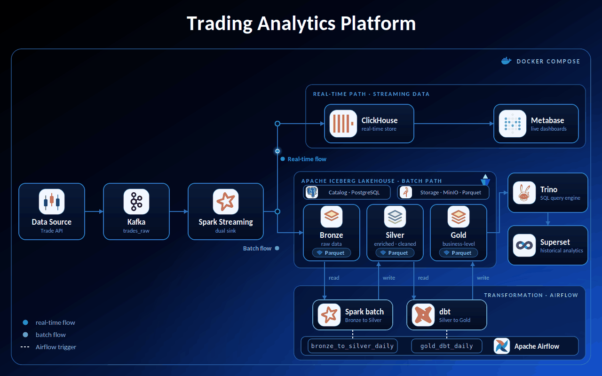
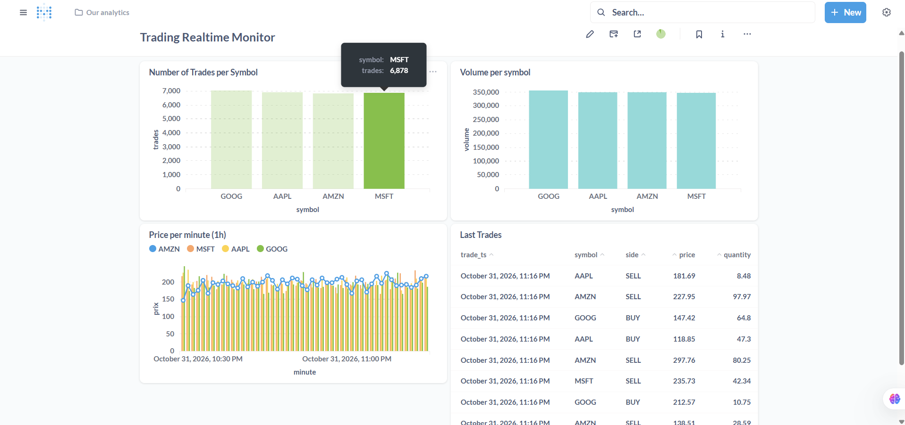
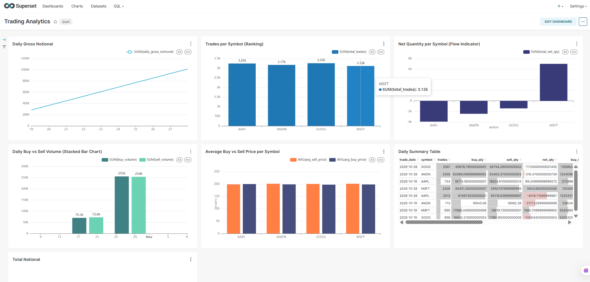

# Trading Analytics Platform

A hybrid **streaming + batch** data platform for trade events, fully containerized with Docker Compose.
Trades flow through Kafka and Spark into a real-time store (ClickHouse → Metabase) and into an Iceberg lakehouse
(Bronze → Silver → Gold) transformed by Spark and dbt, orchestrated by Airflow, and served through Trino to Superset.

## Architecture



| Layer | Technology |
|---|---|
| Ingestion | Python trade producer → Apache Kafka |
| Stream processing | Spark Structured Streaming (dual sink) |
| Real-time store & BI | ClickHouse → Metabase |
| Lakehouse | Apache Iceberg (Parquet) on MinIO, PostgreSQL catalog |
| Batch transformation | Spark (Bronze → Silver), dbt (Silver → Gold) |
| Orchestration | Apache Airflow |
| Query & BI | Trino → Superset |

## Dashboards

### Metabase: real-time monitoring (ClickHouse)



### Superset: historical analytics (Trino / Iceberg Gold)



## Run the pipeline

### Steps

```bash
# 1. Clone and configure
git clone https://github.com/...
cd Trading-Analytics-Platform
cp .env.example .env            # Windows PowerShell: copy .env.example .env

# 2. Start all containers (first start takes several minutes)
make up
make ps                         

# 3. Initialize the Iceberg lakehouse (once)
make init

# 4. Install the ClickHouse driver for Metabase (once)
make metabase-driver

# 5. Start the real-time flow (two terminals)
make producer                   # terminal 1: generates trades into Kafka
make streaming                  # terminal 2: Spark Streaming → ClickHouse + Iceberg Bronze
make count                      # check that trades are arriving in ClickHouse

# 6. Run the batch pipeline: Bronze → Silver (Spark) → Gold (dbt)
make batch